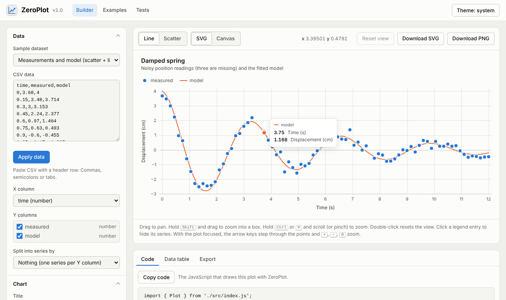

# ZeroPlot

A plotting library for **scatter plots and line plots**, written from scratch in plain HTML, CSS and JavaScript.
No dependencies, no build step, no external requests: every scale, tick, curve, marker and pixel is computed here.

- **Two renderers, one result.** Charts are built as a renderer-agnostic scene and drawn either as **SVG** (crisp, selectable, exportable) or on **Canvas** (fast for hundreds of thousands of points). Both produce the same picture.
- **Proper axes.** Linear, logarithmic and calendar-aware **time** scales; "nice" round tick values; labels that never overlap; compact units (1K, 2.5M); the typographic minus sign.
- **Line and scatter features.** Multiple series, markers in eight shapes, dashes, straight / monotone / step curves, filled areas, gaps for missing values, bubble sizes, reference lines.
- **Interactive.** Tooltips, crosshair, legend toggling, drag to pan, Ctrl/⌘ + wheel or pinch to zoom, Shift + drag box zoom, keyboard navigation.
- **Large data.** Lines are reduced with M4 aggregation (at most four points per pixel column), dense scatter plots fade automatically, and hover uses a spatial index.
- **Accessible.** A colour-vision-deficiency checked palette, light and dark themes, SVG `<title>`/`<desc>`, a screen-reader live region, and a data-table view of every chart.
- **Export.** SVG markup, PNG images and HTML tables.



## Quick start

1. Get the code: clone the repository (or unzip it) and open a terminal in the project folder.
2. Start a local web server. Browsers do not load JavaScript modules from `file://` URLs, so open the pages over HTTP:
   ```sh
   node scripts/serve.js          # or: npm start
   ```
   Any static server works too, for example `python3 -m http.server 8080`.
3. Open <http://localhost:8080> for the **plot builder**, <http://localhost:8080/examples.html> for the **examples gallery** and <http://localhost:8080/test/> for the **test report**.
4. Run the tests from the terminal (Node 18 or newer, no `npm install` needed):
   ```sh
   node test/run.js               # or: npm test
   ```

## Usage

Create a container element and import the library as an ES module.

```html
<div id="chart"></div>
<script type="module">
  import { scatter, line, Plot } from './src/index.js';

  // A scatter plot from [x, y] pairs
  scatter('#chart', [[1, 2], [2, 3.5], [3, 3]], { title: 'Measurements', x: 'Time (s)', y: 'Value' });
</script>
```

```js
// A line plot with two series, dates on the x axis and a smooth curve
const plot = line('#chart', [
  { name: 'Munich', data: rows, x: 'date', y: 'munich', curve: 'monotone' },
  { name: 'San Diego', data: rows, x: 'date', y: 'sanDiego', dash: [6, 4] },
], { title: 'Daily high temperature', y: { label: 'Temperature', suffix: ' °C' } });

// The full constructor gives access to every option
const chart = new Plot(document.querySelector('#chart'), {
  type: 'scatter',
  renderer: 'canvas',
  height: 420,
  x: { label: 'Weight (kg)' },
  y: { label: 'Fuel use (L/100 km)', zero: true },
  series: [
    { name: 'Compact', data: compactCars, x: 'weight', y: 'fuel' },
    { name: 'SUV', data: suvs, x: 'weight', y: 'fuel', marker: { symbol: 'diamond' } },
  ],
});
```

### Data formats

Every series accepts whichever shape your data already has:

| Shape | Example |
| --- | --- |
| `[x, y]` tuples | `data: [[0, 1], [1, 3]]` |
| `{ x, y }` objects | `data: [{ x: 0, y: 1 }]` |
| Named columns | `data: rows, x: 'date', y: 'price'` |
| Accessor functions | `data: rows, x: (d) => d.t / 1000, y: (d) => d.v` |
| Plain numbers (x = index) | `data: [3, 1, 4, 1, 5]` |
| Separate arrays | `x: [0, 1, 2], y: [3, 1, 4]` (typed arrays work too) |

Values may be numbers, numeric strings, `Date` objects or ISO date strings (`'2026-10-10'`, `'2026-10-10 14:30'`).
Date-only strings are read as local midnight. Dates switch the axis to a time scale automatically.
`null`, `NaN` and empty strings become gaps in the line.

### Options

All options are optional. Strings work as shorthand: `x: 'Time'` sets the axis title, `legend: 'right'` its position, `legend: false` hides it.

| Option | Default | Description |
| --- | --- | --- |
| `type` | `'line'` | Default series type, `'line'` or `'scatter'` |
| `renderer` | `'svg'` | `'svg'` or `'canvas'` |
| `width` | `null` | Pixel width; `null` follows the container (resizes automatically) |
| `height` | `360` | Pixel height; `null` uses the container height |
| `title`, `subtitle` | `''` | Text above the chart |
| `description` | auto | Accessible description (generated from the data if empty) |
| `theme` | `'auto'` | `'auto'` follows the OS and `<html data-theme>`; `'light'`, `'dark'` or an object of overrides |
| `padding` | `16` | Outer padding in px, or `{ top, right, bottom, left }` |
| `legend.show` | `'auto'` | `'auto'` shows a legend for two or more series |
| `legend.position` | `'top'` | `'top'`, `'right'` or `'bottom'` |
| `tooltip.show` | `true` | Show the tooltip and hover highlight |
| `tooltip.mode` | `'auto'` | `'x'` (all series at the hovered x), `'nearest'` (closest point); auto picks `'nearest'` when there are scatter series |
| `tooltip.content` | — | `(points) => { title, rows } \| Node \| string` to customise the tooltip |
| `crosshair` | `true` | Vertical hairline in `'x'` mode |
| `interaction.zoom` | `'xy'` | Axes that zoom and pan: `'xy'`, `'x'`, `'y'` or `false` |
| `interaction.pan` | `true` | Drag to pan |
| `interaction.wheel` | `'ctrl'` | `'ctrl'` (wheel zooms only with Ctrl/⌘, so the page still scrolls), `'always'` or `false` |
| `interaction.keyboard` | `true` | Arrow keys, `+`, `−`, `0` when the chart has focus |
| `annotations` | `[]` | Reference lines: `{ type: 'hline' \| 'vline', value, label?, color?, dash? }` |
| `series` | `[]` | The data series (see below) |

**Axes** (`x` and `y`):

| Option | Default | Description |
| --- | --- | --- |
| `label` | `''` | Axis title |
| `scale` | `'auto'` | `'linear'`, `'log'` or `'time'`; auto picks time for dates |
| `min`, `max` | `null` | Fix one or both ends |
| `nice` | x: `'auto'`, y: `true` | Extend the axis to round tick values (auto: on unless the x axis shows only lines) |
| `zero` | `false` | Always include zero |
| `ticks` | `null` | Approximate tick count; derived from the size when `null` |
| `format` | `'auto'` | `'percent'`, `'compact'`, `'fixed:2'` or `(value) => string` |
| `prefix`, `suffix` | `''` | Units around every label, e.g. `prefix: '$'`, `suffix: ' ms'` |
| `grid` | `true` | Grid lines |
| `line` | x: `true`, y: `false` | Axis rule |

**Series**:

| Option | Default | Description |
| --- | --- | --- |
| `name` | `'Series n'` | Legend and tooltip label |
| `id` | name | Stable key for `setData()` and `toggleSeries()` |
| `type` | chart `type` | `'line'` or `'scatter'` |
| `color` | palette | Any CSS colour; defaults to the next palette slot |
| `lineWidth` | `2` | Line width in px |
| `dash` | `null` | Dash pattern, e.g. `[6, 4]` |
| `curve` | `'linear'` | `'linear'`, `'monotone'`, `'step'`, `'step-before'`, `'step-after'` |
| `area` | `false` | Fill the area under the line |
| `markers` | scatter: `true` | Draw point markers on a line |
| `marker.symbol` | `'auto'` | `'circle'`, `'square'`, `'triangle'`, `'diamond'`, `'cross'`, `'plus'`, `'star'`, `'triangle-down'` |
| `marker.size` | `8` | Diameter in px, or `(datum, index) => px` for bubble charts |
| `marker.opacity` | `'auto'` | Auto fades dense scatter plots so overlaps show density |
| `visible` | `true` | Start hidden with `false` (the legend can show it again) |

### Methods and events

| Method | Description |
| --- | --- |
| `update(options)` | Merge new options and redraw. New `series` reset the zoom. |
| `setData(series, data)` | Replace one series' data by index, id or name (live data) |
| `setRenderer('svg' \| 'canvas')` | Switch the renderer |
| `toggleSeries(series, visible?)` | Show or hide a series |
| `setView({ x, y })`, `resetZoom()`, `view`, `isZoomed` | Read and control the zoom window |
| `toSVG()` | Standalone SVG document as a string |
| `toPNG(scale = 2)` | `Promise<Blob>` with a PNG image |
| `toCanvas(scale = 2)` | A new canvas with the chart drawn on it |
| `download('png' \| 'svg', filename?)` | Save the chart as a file |
| `dataTable({ maxRows })` | The visible data as an accessible `<table>` |
| `on(event, handler)` / `off(...)` | Subscribe to `'hover'`, `'click'`, `'viewchange'`, `'toggle'`, `'render'` |
| `destroy()` | Remove the chart and all listeners |

```js
plot.on('click', ({ x, y, points }) => console.log('clicked at', x, y, 'nearest:', points));
plot.on('viewchange', ({ view }) => console.log('zoomed to', view.x, view.y));
```

### Interaction

| Input | Action |
| --- | --- |
| Hover / tap | Tooltip and highlight |
| Drag | Pan |
| Ctrl/⌘ + scroll, trackpad pinch, two-finger pinch | Zoom around the pointer |
| Shift + drag | Zoom into a box |
| Double-click | Reset the view |
| Legend click | Show or hide a series |
| Arrow keys (chart focused) | Step through points; Up/Down switch series in scatter plots |
| Shift + arrow keys | Pan |
| `+` / `−` / `0` | Zoom in, zoom out, reset |

The low-level building blocks are exported too (`LinearScale`, `LogScale`, `TimeScale`, `linearTicks`, `timeTicks`, `buildScene`, `renderSVG`, `renderCanvas`, `decimateM4`, ...), for example to render an SVG string on a server.

## Project structure

```
zeroplot/
├── index.html              Plot builder (CSV in, plot + code out)
├── examples.html           Examples gallery
├── src/                    The library (ES modules, no dependencies)
│   ├── index.js            Public API
│   ├── plot.js             Plot class: DOM, events, zoom/pan, export
│   ├── core/
│   │   ├── scale.js        Linear, log and time scales
│   │   ├── ticks.js        Nice numbers and tick generation
│   │   ├── time.js         Calendar-aware time ticks and labels
│   │   ├── format.js       Number formatting
│   │   ├── curves.js       Line interpolation and M4 decimation
│   │   ├── symbols.js      Marker shapes (equal area)
│   │   ├── path.js         Renderer-independent path
│   │   ├── data.js         Input normalisation
│   │   ├── options.js      Defaults and option merging
│   │   ├── theme.js        Light/dark themes and palette
│   │   └── text.js         Text measurement
│   ├── scene/build.js      Layout + scene graph (the core)
│   ├── render/svg.js       Scene -> SVG markup
│   ├── render/canvas.js    Scene -> Canvas 2D calls
│   └── interaction/        Hit testing and tooltips
├── site/                   Code and styles of the two pages
├── test/                   Test harness, specs, Node + browser runners
├── scripts/serve.js        Zero-dependency dev server
└── docs/ARCHITECTURE.md    How the library works
```

## How it works

Rendering is a pipeline of pure steps, so each one can be tested on its own:

```
options + data ──► normalise ──► scales & ticks ──► layout ──► scene (primitives) ──► SVG string
                                                                                └──► Canvas draw calls
```

The scene builder never touches the DOM, which is why the same scene renders as SVG or Canvas and why most tests run in Node. Hover feedback is drawn on a separate overlay, so moving the pointer never redraws the chart. See [docs/ARCHITECTURE.md](docs/ARCHITECTURE.md) for the algorithms (nice numbers, monotone curves, M4, the spatial index) and design decisions.

## Browser support

Current versions of Chrome, Edge, Firefox and Safari (ES2020 modules, Pointer Events, ResizeObserver). Nothing to compile.

## License

[MIT](LICENSE)
