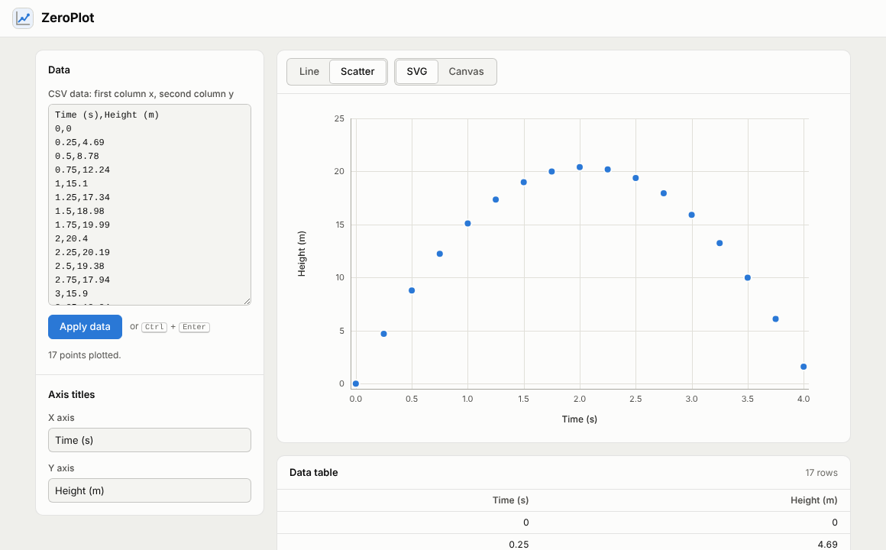

# ZeroPlot

Paste CSV data and get a line plot or a scatter plot. Written from scratch in plain HTML, CSS and JavaScript:
no libraries, no build step, no external requests.



## Features

- Paste CSV data and click **Apply data**. The first column is x, the second column is y.
- **Line** or **scatter** plot.
- **SVG** or **Canvas** output. Both are drawn from the same scene, so they look the same.
- Editable **axis titles** for x and y (taken from the CSV header row by default).
- **Automatic axis scaling** with round tick values (1, 2 or 5 times a power of ten).
- **Fixed layout**: the plot is always 720 × 440 px with a vertical and a horizontal grid.
- **Data table** with the plotted values.

CSV details: a header row is optional; commas, semicolons and tabs are accepted; with semicolons or tabs, decimal commas
(`21,5`) work, as exported by German Excel. Rows without two numbers are skipped and counted, extra columns are ignored.

## Run it

1. Open a terminal in the project folder.
2. Start a local web server (browsers do not load JavaScript modules from `file://`):
   ```sh
   node scripts/serve.js
   ```
   Any static server works too, for example `python3 -m http.server 8080`.
3. Open <http://localhost:8080>.

## Tests

```sh
node test/run.js
```

Node 18 or newer, no `npm install`. The same specs run in the browser at <http://localhost:8080/test/index.html>,
including the tests that need a DOM. The test harness (`test/harness.js`) is part of the project, so tests need no framework either.

## Use the library on its own

```html
<div id="chart"></div>
<script type="module">
  import { Plot, parseCSV } from './src/index.js';

  const { points, xLabel, yLabel } = parseCSV('Time (s),Height (m)\n0,0\n1,15.1\n2,20.4');
  const plot = new Plot(document.getElementById('chart'), { points, xLabel, yLabel });

  plot.update({ type: 'scatter', renderer: 'canvas' });
</script>
```

| Option | Values | Default |
| --- | --- | --- |
| `points` | `[[x, y], ...]` | `[]` |
| `type` | `'line'`, `'scatter'` | `'line'` |
| `renderer` | `'svg'`, `'canvas'` | `'svg'` |
| `xLabel`, `yLabel` | any text | `'x'`, `'y'` |

## How it works

```
CSV text ──► parseCSV ──► points ──► buildScene ──► primitives ──► renderSVG    (SVG markup)
                                       │                     └──► renderCanvas (canvas draw calls)
                                       └── niceAxis: automatic, round axis ranges and ticks
```

| File | Responsibility |
| --- | --- |
| `src/csv.js` | Parse pasted CSV into `[x, y]` points and default axis titles |
| `src/scale.js` | Nice tick values (Heckbert's 1-2-5 rule) and the linear data-to-pixel mapping |
| `src/format.js` | Tick labels: shared precision, compact units (5K, 2M), typographic minus |
| `src/scene.js` | Fixed layout, grid, axes, line or markers, as renderer-independent primitives |
| `src/render-svg.js` | Primitives to an SVG string (labels are escaped) |
| `src/render-canvas.js` | Primitives to Canvas 2D calls, sharp on high-density screens |
| `src/plot.js` | The `Plot` component: puts the chart into a container and redraws on `update()` |
| `site/app.js` | The page: CSV input, controls and the data table |

Because the scene never touches the DOM, layout and both renderers are tested in Node.

## Version history

This is a deliberately small base. A larger prototype with time and log axes, zoom and pan, tooltips, multiple series,
themes and an examples gallery is kept in git under the tag `prototype-full`. Bring a part back with, for example:

```sh
git show prototype-full:src/core/time.js
```

## License

[MIT](LICENSE)
