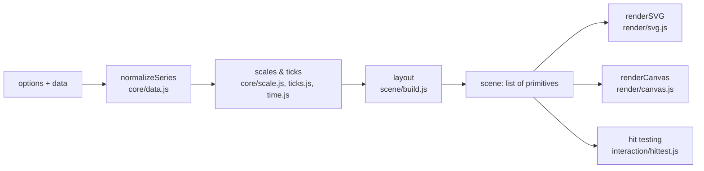

# Architecture

ZeroPlot turns options and data into a picture in a fixed sequence of steps. Each step is a plain function or class
with no knowledge of the steps after it, which keeps the code testable and lets two very different renderers share
everything except the last step.

## Modules and responsibilities

| Module | Responsibility | DOM? |
| --- | --- | --- |
| `core/data.js` | Accept every supported input shape and produce `Float64Array`s of x and y. Parse dates (date-only ISO strings as local time). Flag sorted series. | no |
| `core/options.js` | Defaults, deep merge (arrays replace), shorthand expansion. | no |
| `core/ticks.js` | Nice tick steps, nice domains, log ticks. | no |
| `core/time.js` | Calendar intervals, flooring/offsetting dates, multi-scale labels. | no |
| `core/scale.js` | `map` / `invert` between data and pixels for linear, log and time axes. | no |
| `core/format.js` | Shared-precision tick labels, compact units, tooltip numbers. | no |
| `core/curves.js` | Linear, step and monotone paths, area paths, M4 decimation. | no |
| `core/symbols.js` | Marker polygons with equal area. | no |
| `core/path.js` | A path type whose commands both renderers can replay. | no |
| `core/text.js` | Text width measurement (canvas in browsers, estimate in Node). | optional |
| `scene/build.js` | Layout (margins, legend, tick density), grid, data marks, legend boxes. Returns plain data. | no |
| `render/svg.js` | Scene to SVG markup (a string). | no |
| `render/canvas.js` | Scene to Canvas 2D calls, sized for the device pixel ratio. | canvas only |
| `interaction/hittest.js` | Nearest point (grid index) and nearest x (binary search). | no |
| `interaction/tooltip.js` | Tooltip DOM (text only via `textContent`) and the injected stylesheet. | yes |
| `plot.js` | The public component: DOM layers, events, zoom/pan, resize, theme changes, export. | yes |

## The scene

A scene is an array of primitives in CSS pixels: `rect`, `line`, `path`, `text`, `markers` and `group` (with an optional
clip rectangle and opacity). This is the only contract between layout and drawing.

- **Why not draw directly?** With an intermediate scene, SVG and Canvas output are guaranteed to show the same chart,
  the layout can be unit-tested without a browser, and new renderers (WebGL, PDF) only need to understand six primitive types.
- **Text alignment.** SVG `dominant-baseline` behaves differently across browsers. Both renderers instead use the
  alphabetic baseline plus the same em-based offset (`core/text.js#baselineShift`), so labels line up identically.
- **Markers as one primitive.** A whole series of markers is a single `markers` primitive. Up to 2,500 points are drawn
  individually so each one gets a background-coloured ring that separates overlapping points; beyond that they are
  batched into one path (SVG) or one fill call (Canvas).

## Algorithms

**Nice numbers.** Tick steps are 1, 2 or 5 times a power of ten, chosen with thresholds at the geometric means
(√2, √10, √50) — the rule from Paul Heckbert, *Nice Numbers for Graph Labels*, Graphics Gems (1990). Domains are
extended to multiples of that step in a single pass, and the scale remembers the step (`tickStepHint`) so the ticks
line up with the extended ends. Recomputing the step for the widened domain, as some libraries do, can escalate it
(`[-2.1, 5.3]` → `[-4, 6]` → `[-5, 10]`) and leave much of the plot empty.

**Tick density.** The y axis targets one tick per ~56 px. The x axis starts from one tick per ~90 px and lowers the
count until no two labels are closer than 14 px; if the last label would stick out of the chart, the right margin grows.

**Time ticks.** The interval (1 s … 1 year, or 1-2-5 multiples of years) closest to the requested count is chosen on a
log scale, the first tick is the domain start rounded down to that interval, and later ticks are produced with `Date`
setters so month lengths and daylight-saving changes are handled by the platform. Labels show the coarsest field that
changes at each tick: `2026`, `Feb`, `Feb 12`, `14:30`, `:45`.

**Monotone curves.** Steffen's method (M. Steffen, *A simple method for monotonic interpolation in one dimension*,
Astronomy & Astrophysics 239, 1990) chooses Bézier tangents that never overshoot the data, so a smoothed line never
suggests values that were not measured.

**M4 decimation.** For sorted lines with more than four points per pixel, each pixel column keeps only its first,
minimum, maximum and last point (Jugel et al., *M4: A Visualization-Oriented Time Series Data Aggregation*,
VLDB 2014). The drawn line is pixel-identical, but 200,000 points shrink to about 2,000.

**Marker padding.** Markers at the data extremes would be cut in half by the plot edge. After nicing, the domain is
widened just enough (in the scale's working space, so it also works on log axes) that every marker sits at least its
radius plus ring inside the plot.

**Hit testing.** Points are bucketed into a 32 px grid when the pointer first needs them, so finding the nearest point
checks a few cells instead of every point. In shared-x mode a binary search per sorted series finds the nearest x.
Bubbles are measured to their edge, so the pointer anywhere inside a bubble hits it.

**Zoom and pan** work purely through `scale.invert`: the new domain is whatever data lies under the zoomed or shifted
pixel range. That makes the same code correct for linear, log and time axes.

## Design decisions

- **Colour.** The eight-colour categorical palette was validated for colour-vision deficiency (adjacent pairs stay
  distinguishable under protan, deutan and tritan simulation) in both themes. Colours follow the series' position in the
  options, never its visibility, so hiding a series does not repaint the others. With more than three scatter series,
  marker shapes vary as a second channel.
- **Quiet chrome.** Hairline solid grid lines, tick labels in secondary text colour, a stronger zero line only when zero
  is inside the data range.
- **Security.** Labels often come from CSV headers. SVG output escapes all text; tooltips and tables use `textContent`.
- **Cooperative scrolling.** By default the wheel zooms only with Ctrl/⌘ (a hint appears otherwise) so a page full of
  charts still scrolls; trackpad pinch sends Ctrl+wheel and therefore zooms.
- **Accessibility.** SVG `<title>`/`<desc>` with a generated description, `role="img"` on canvas, a focusable chart with
  keyboard navigation announced through a live region, and `dataTable()` as the non-visual equivalent of every chart.

## Extending

- **A new renderer** implements one function `(scene, target) => void` that handles the six primitive types.
- **A new mark type** (e.g. error bars) adds a branch to the data loop in `scene/build.js` that emits existing primitives.
- **A new scale** extends `LinearScale` and overrides `transform`/`untransform` (working space), `ticks` and `tickFormatter`;
  zoom, pan, layout and hit testing then work without changes.
