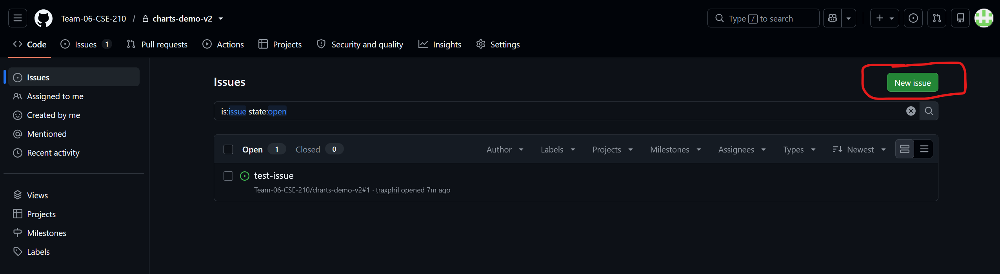
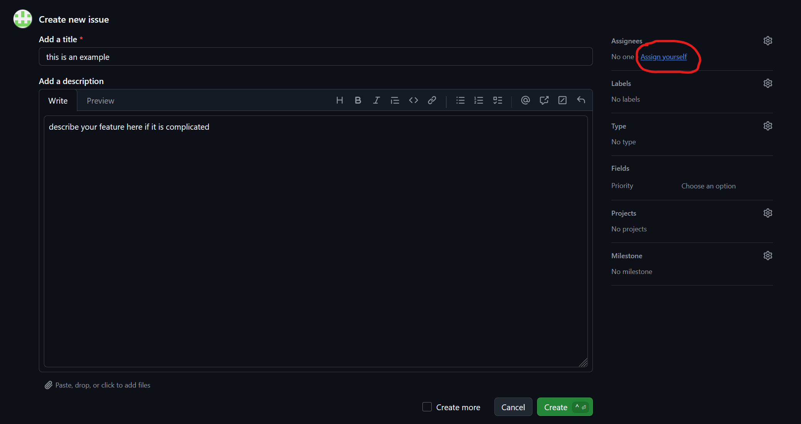
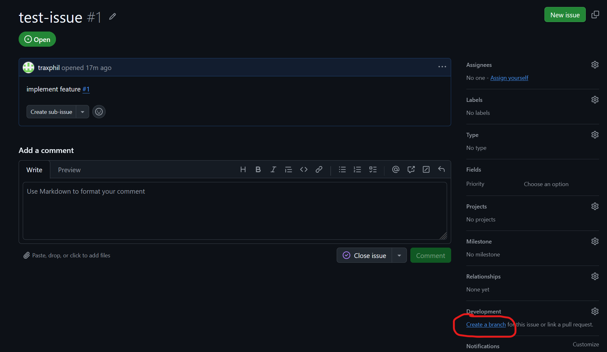
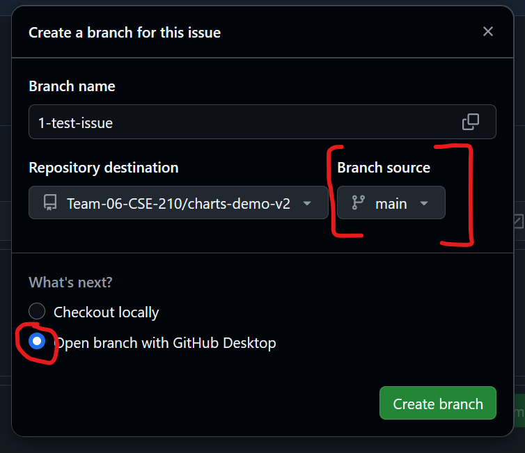

# Workflows

## Issue-Based Workflow

Every change starts as an issue on GitHub. The branch is created from that issue, not locally, so GitHub links the two: the branch name carries the issue number, and the issue shows which branch and pull request belong to it.

The steps in short:

1. Create an issue and assign yourself.
2. Create the branch from the issue page.
3. Fetch the repo and switch to the branch locally.

### 1. Create an issue

Open the **Issues** tab of the repository and click **New issue**.



Give the issue a short title that says what will be done. The title becomes part of the branch name, so keep it brief. Add a description if the feature needs explaining.

Click **Assign yourself** under **Assignees** so the team can see who is working on it, then click **Create**.



### 2. Create the branch from the issue

Open the issue you just created. In the right sidebar under **Development**, click **Create a branch**.



A dialog opens:

- **Branch name**: leave the suggested name. It follows the pattern `<issue-number>-<issue-title>`, for example `1-test-issue`.
- **Branch source**: make sure this is `main`, so the branch starts from the latest state of the project.
- **What's next?**: choose how you want to get the branch onto your machine.
  - **Checkout locally** shows you the Git commands from step 3.
  - **Open branch with GitHub Desktop** (selected in the screenshot) opens the branch in GitHub Desktop, which fetches and switches for you.

Click **Create branch**. The branch now exists on GitHub, but not yet on your machine.



### 3. Fetch the repo and switch to the branch

In your local clone of the repository, fetch the new branch from GitHub and switch to it. Replace `1-test-issue` with your branch name:

```sh
git fetch origin
git switch 1-test-issue
```

`git fetch origin` downloads the branch that was created on GitHub. `git switch` then creates a local branch of the same name that tracks `origin/1-test-issue`, so `git push` and `git pull` work without further setup.

Check that you are on the right branch before you start working:

```sh
git status
```

The first line should read `On branch 1-test-issue`.
